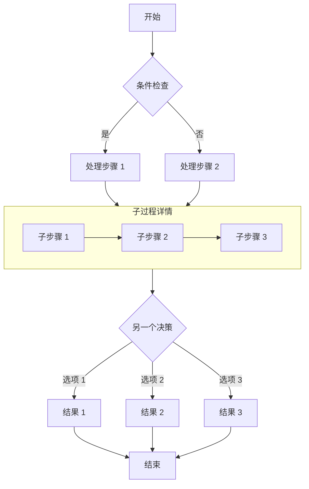

## 成功解鎖了這篇文章！

如果你能看到這段內容，說明密碼輸入正確，文章已成功解密。

### 功能說明

- **構建時加密**：文章內容在構建時使用 AES-256-GCM 算法加密，頁面源碼中不包含任何明文。
- **客戶端解密**：訪客輸入正確密碼後，瀏覽器通過 Web Crypto API 在本地完成解密。
- **會話緩存**：同一瀏覽器會話內，密碼會被緩存到 `sessionStorage`，刷新頁面無需重複輸入。
- **關閉即失效**：關閉瀏覽器後緩存清除，再次訪問需要重新輸入密碼。

> 密碼為 `123456`，僅供測試使用。

## 圖片


## GitHub 倉庫卡片

::github{repo="CuteLeaf/Firefly"}

## 提示框

> [!NOTE] NOTE
> 突出顯示用戶應該考慮的信息。

> [!TIP] TIP
> 可選信息，幫助用戶更成功。

> [!NOTE] 自定義標題
> 這是一個帶有自定義標題的示例。

## 數學公式
### 行內公式 (Inline)

歐拉公式 $e^{i\pi} + 1 = 0$ 是數學中最優美的公式之一。

質能方程 $E = mc^2$ 也是家喻戶曉。

### 塊級公式 (Block)

塊級公式使用兩個 `$$` 符號包裹，會居中顯示。

$$
\int_{-\infty}^{\infty} e^{-x^2} dx = \sqrt{\pi}
$$

$$
x = \frac{-b \pm \sqrt{b^2 - 4ac}}{2a}
$$

### 化學方程式 (Chemical Equations)

$$
\ce{CH4 + 2O2 -> CO2 + 2H2O}
$$

## 代碼塊
#### 常規語法高亮

```js
console.log('此代码有语法高亮!')
```

#### 渲染 ANSI 轉義序列

```ansi
ANSI colors:
- Regular: Red Green Yellow Blue Magenta Cyan
- Bold:    Red Green Yellow Blue Magenta Cyan
- Dimmed:  Red Green Yellow Blue Magenta Cyan

256 colors (showing colors 160-177):
160 161 162 163 164 165
166 167 168 169 170 171
172 173 174 175 176 177

Full RGB colors:
ForestGreen - RGB(34, 139, 34)

Text formatting: Bold Dimmed Italic Underline
```


## 流程圖

