## Markdown 中 Mermaid 圖表完整指南

本文演示如何在 Markdown 文檔中使用 Mermaid 創建各種複雜圖表，包括流程圖、時序圖、ER 圖、類圖、狀態圖、XY 圖、甘特圖、思維導圖等。

> Mermaid 圖表由 [Merman](https://github.com/Latias94/merman) 實現。Firefly 在 Astro 構建階段生成亮色和深色兩套靜態 SVG，無需在瀏覽器中加載 Mermaid 渲染運行時。可以前往 [Merman Playground](http://frankorz.com/merman/) 實時編輯語法並預覽渲染結果。

## 流程圖示例

流程圖非常適合表示流程或算法步驟。


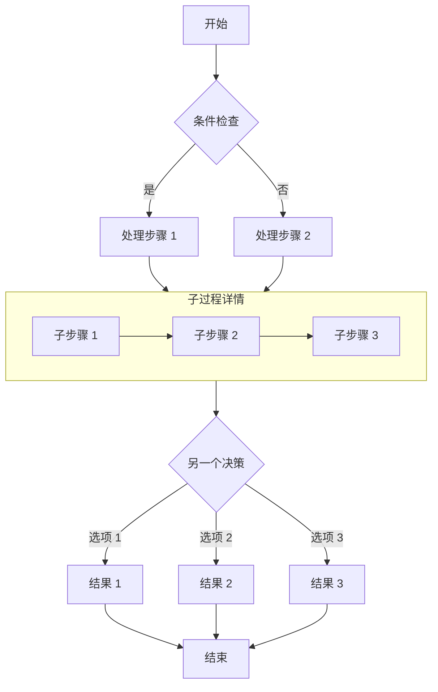

## 時序圖示例

時序圖顯示對象之間隨時間的交互。

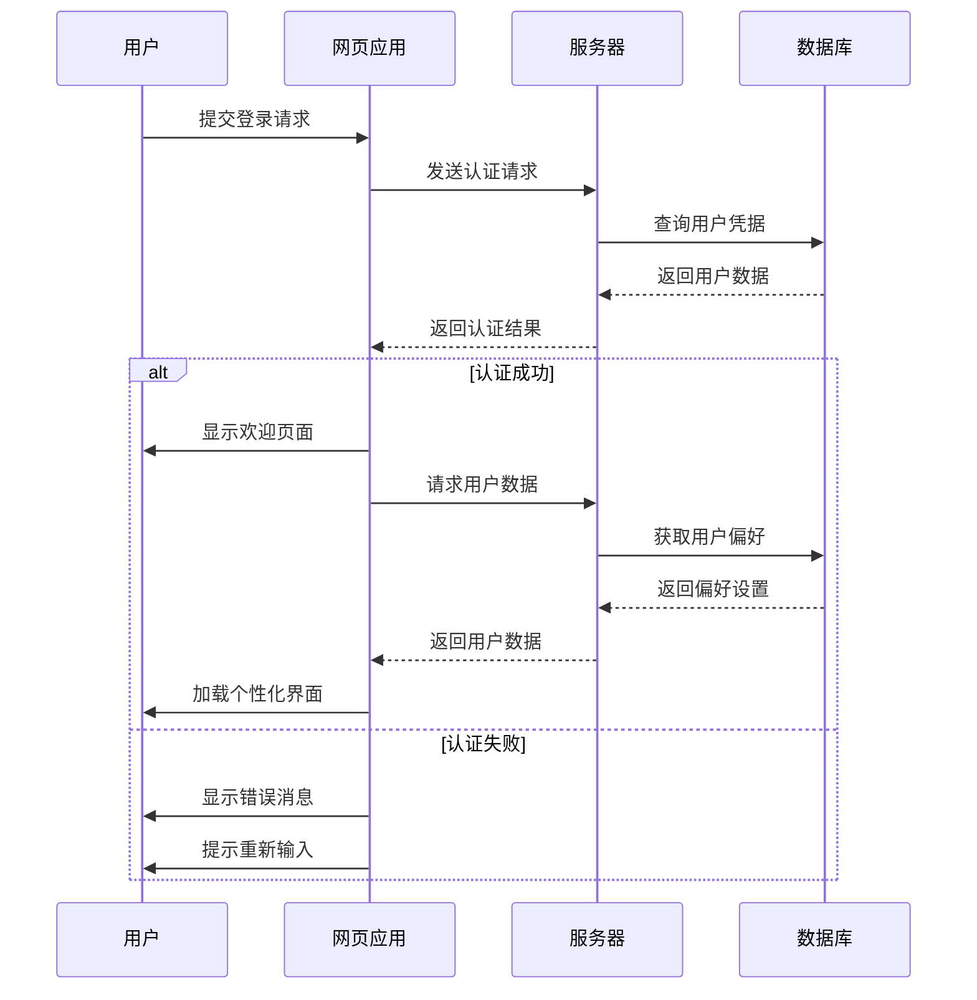

## ER 圖示例

ER 圖（實體關係圖）非常適合表示數據庫結構。

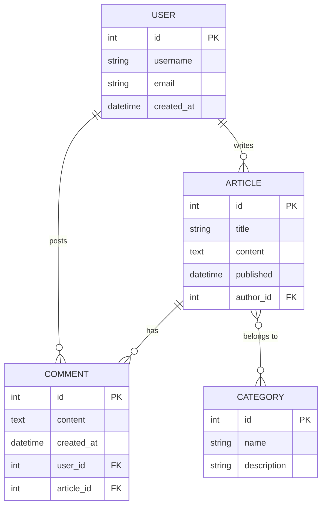

## 類圖示例

類圖顯示系統的靜態結構，包括類、屬性、方法及其關係。

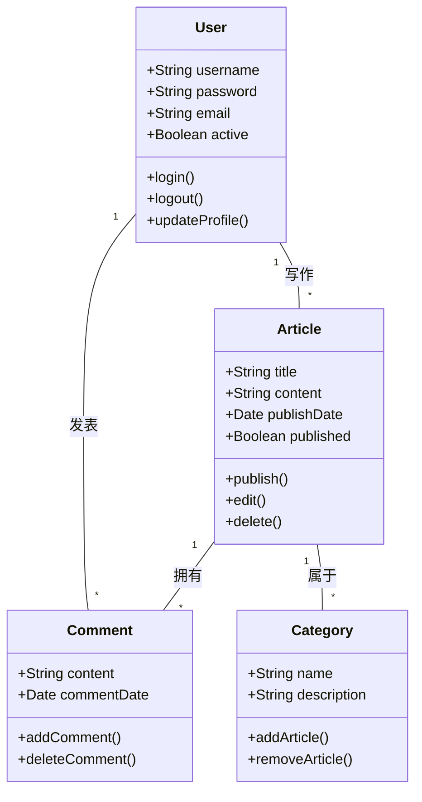

## 狀態圖示例

狀態圖顯示對象在其生命週期中經歷的狀態序列。

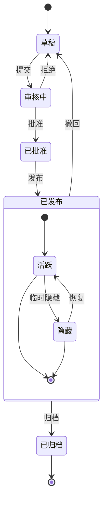

## XY 圖示例

XY 圖表非常適合展示趨勢和對比數據。

```mermaid
xychart-beta
    title "月度访问量趋势"
    x-axis [1月, 2月, 3月, 4月, 5月, 6月]
    y-axis "访问量" 0 --> 5000
    bar [2500, 3200, 4100, 3800, 4500, 4800]
    line [2500, 3200, 4100, 3800, 4500, 4800]
```

## 餅圖示例

餅圖適合直觀展示各部分在整體中的佔比。

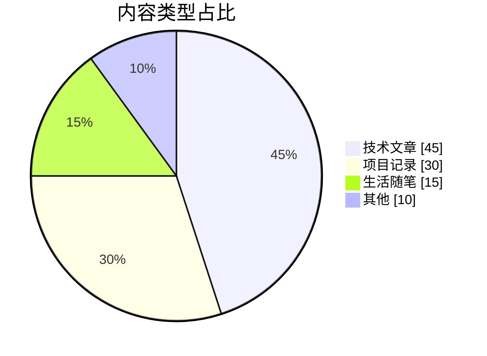

## 甘特圖示例

甘特圖可以按時間軸展示項目階段、任務依賴和當前進度。

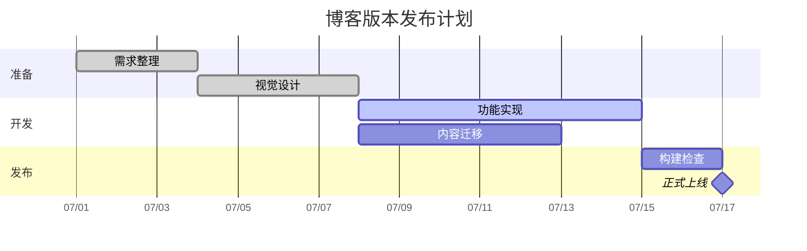

## 思維導圖示例

思維導圖適合梳理主題層級和知識結構。

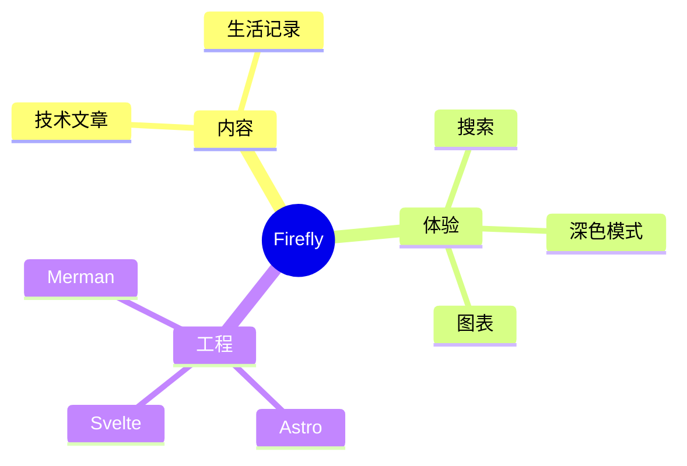

## 時間線示例

時間線用於按年份或階段呈現項目的重要事件。

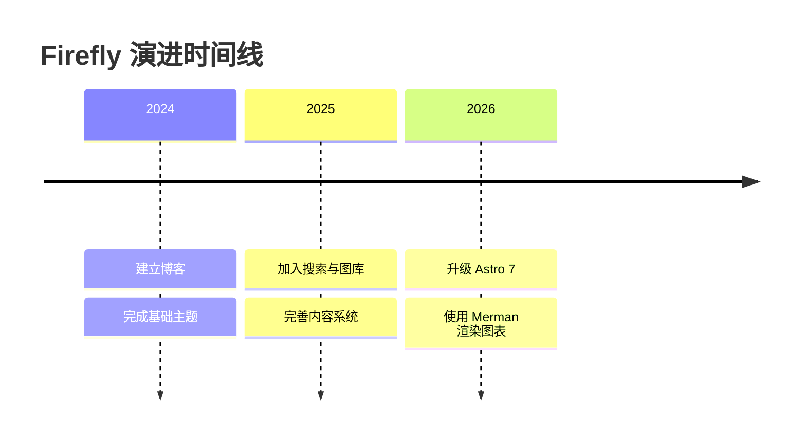

## 用戶旅程圖示例

用戶旅程圖能夠描述用戶在不同階段的行為和體驗評分。

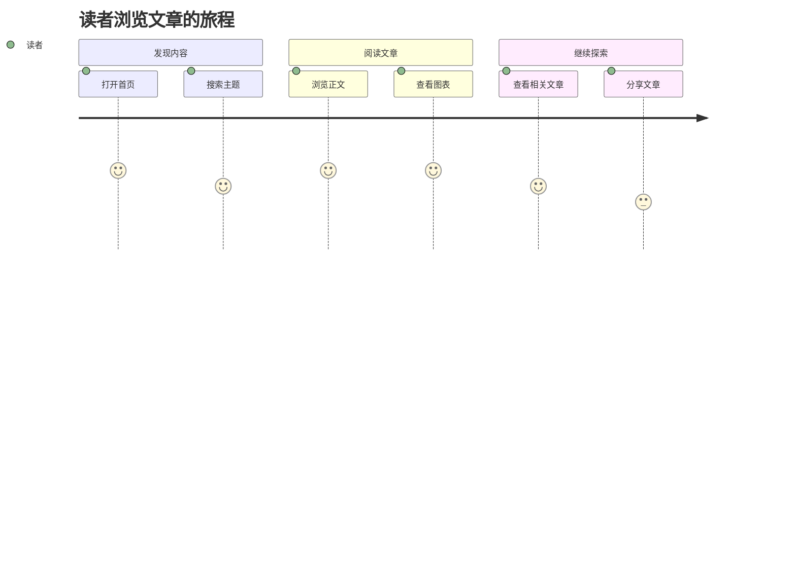

## Git 圖示例

Git 圖可以清晰展示分支、提交和合並歷史。

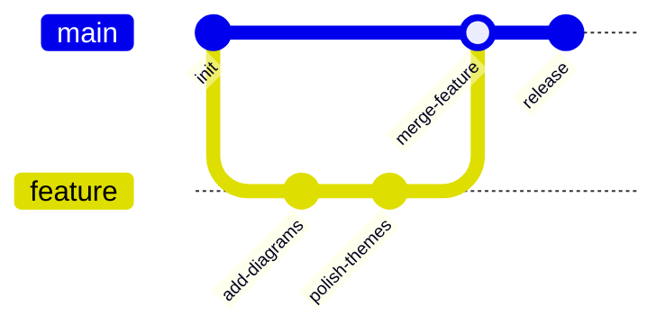

## 看板示例

看板適合展示任務在不同工作階段之間的分佈。

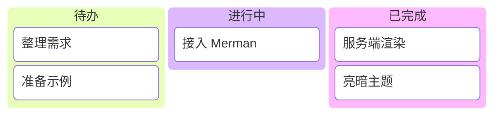

## Sankey 圖示例

Sankey 圖通過連線寬度展示流量在不同節點之間的流向。

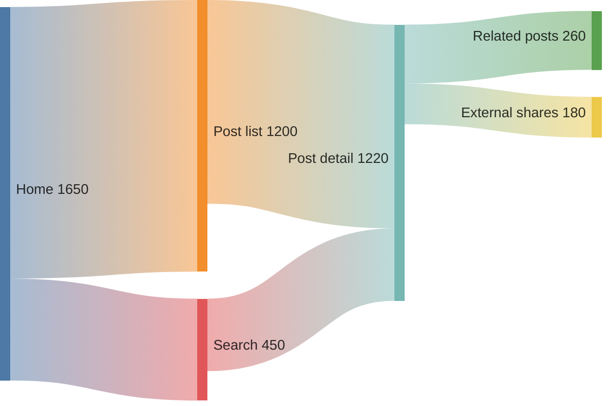

## 總結

Mermaid 是在 Markdown 文檔中創建各種類型圖表的強大工具。本文演示了流程圖、時序圖、ER 圖、類圖、狀態圖、XY 圖、餅圖、甘特圖、思維導圖、時間線、用戶旅程圖、Git 圖、看板和 Sankey 圖。這些圖表可以幫助您更清晰地表達複雜的概念、流程和數據結構。

要使用 Mermaid，只需在代碼塊中指定 mermaid 語言，並使用簡潔的文本語法描述圖表。圖表會在構建時自動渲染為 SVG，無需客戶端 JavaScript 加載。

可以前往 [Merman Playground](http://frankorz.com/merman/) 嘗試更多語法，再將圖表代碼粘貼到文章中。
